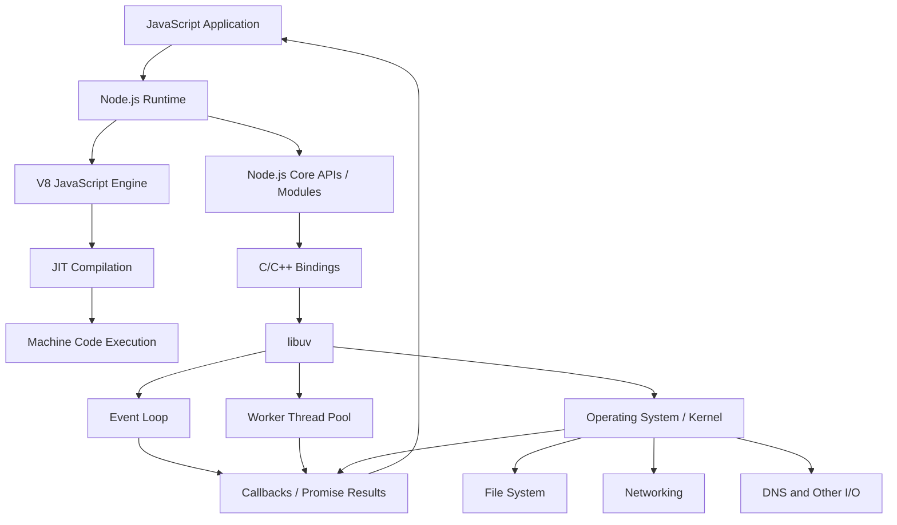

## 1. What is Node.js?

**Node.js is a JavaScript runtime environment** that allows JavaScript to run outside a web browser, commonly on servers.

- In a browser, JavaScript is executed by the browser's JavaScript engine.
- Node.js uses **Google Chrome's V8 JavaScript engine** to execute JavaScript.
- Node.js also provides APIs for tasks such as working with files, networking, timers and processes.
- It is commonly used to build backend services, APIs and command-line tools.

> **Remember:** Node.js is not a programming language or a framework. It is a runtime environment for JavaScript.

## 2. Main Components of Node.js

Node.js is commonly explained through three important components:

1. **V8 Engine**
2. **libuv Library**
3. **C/C++ Bindings**

### A. V8 JavaScript Engine

V8 is the JavaScript engine developed by Google and used by Chrome and Node.js.

Its main job is to execute JavaScript code.

- V8 compiles JavaScript into machine code.
- It uses **Just-In-Time (JIT) compilation**, which compiles code while the program is running.
- It also manages JavaScript memory, including garbage collection.

**JIT = Just-In-Time:** code is compiled during execution rather than requiring the developer to manually compile JavaScript beforehand. 

```bash

ex => node --watch file_name.js

```

### B. libuv Library

**libuv** is a C library that provides Node.js with asynchronous I/O capabilities.

Its responsibilities include:

- Event loop management.
- Thread-pool support for certain operations.
- File-system operations.
- Networking support.
- DNS lookup support.
- Timers and other asynchronous operations.

The event loop helps Node.js handle many I/O operations without blocking the main JavaScript thread while those operations are waiting.

**Important:** JavaScript normally runs on one main thread in Node.js, but some work can be handled by the operating system or libuv's worker thread pool. Therefore, Node.js can handle asynchronous operations efficiently.

### C. C/C++ Bindings

Bindings act as a bridge between JavaScript and lower-level native code.

For example:

1. Your JavaScript code calls `fs.readFile()`.
2. Node.js connects that API to its native implementation through bindings.
3. The native layer works with libuv and the operating system to perform the file operation.
4. The result is made available to JavaScript, usually through a callback, promise or other asynchronous mechanism.

Bindings allow JavaScript to access operating-system and native capabilities.

## 3. Node.js Architecture Diagram

The following diagram shows the relationship between the main components:




## 4. How an Asynchronous File Operation Works

Example:

```javascript
const fs = require("fs");

fs.readFile("notes.txt", "utf8", (err, data) => {
    if (err) {
        console.error(err);
        return;
    }

    console.log(data);
});

console.log("Reading file...");
```

Typical flow:

1. JavaScript calls `fs.readFile()`.
2. Node.js starts the file-system operation through its native layers.
3. The operation is handled using the available operating-system or libuv mechanisms.
4. JavaScript can continue executing other code instead of waiting synchronously.
5. When the operation finishes, its callback is scheduled and eventually executed by the event loop.

**Possible output:**

```text
Reading file...
(contents of notes.txt)
```

The exact mechanism used depends on the operation and platform. Not every asynchronous operation uses the thread pool; some use operating-system facilities directly.

## 5. Quick Revision

| Component | Main responsibility |
|-----|---|
| **V8** | Executes JavaScript and uses JIT compilation |
| **libuv** | Provides the event loop and asynchronous I/O support |
| **C/C++ Bindings** | Connect JavaScript APIs to native code |
| **Event Loop** | Coordinates when asynchronous callbacks are executed |
| **Thread Pool** | Handles certain tasks away from the main JavaScript thread |
| **Operating System** | Provides file, network and other system-level services |

### Key points to remember

- Node.js runs JavaScript outside the browser.
- V8 is the JavaScript engine.
- JIT means **Just-In-Time compilation**.
- libuv provides the event loop and asynchronous I/O support.
- C/C++ bindings connect JavaScript APIs with native functionality.
- JavaScript generally runs on one main thread; this does not mean all Node.js work is single-threaded.
- Node.js is especially useful for I/O-heavy applications such as APIs and network services.

## One-line summary
```
**
Node.js = V8 (JavaScript execution) + libuv (event loop and asynchronous I/O) + native bindings (bridge to system-level functionality).
**


output_path = "/mnt/data/nodejs_summarised_notes.md"
pypandoc.convert_text(
    markdown,
    to="md",
    format="md",
    outputfile=output_path,
    extra_args=["--standalone"]
)
print(f"Created: {output_path}")
